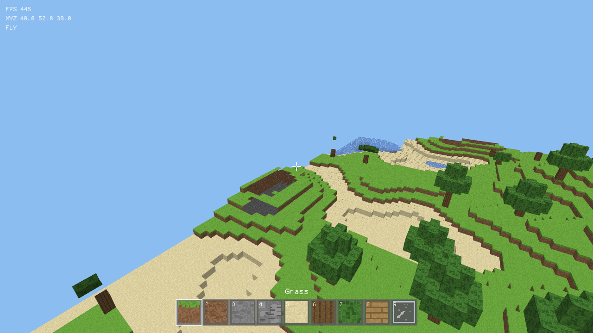
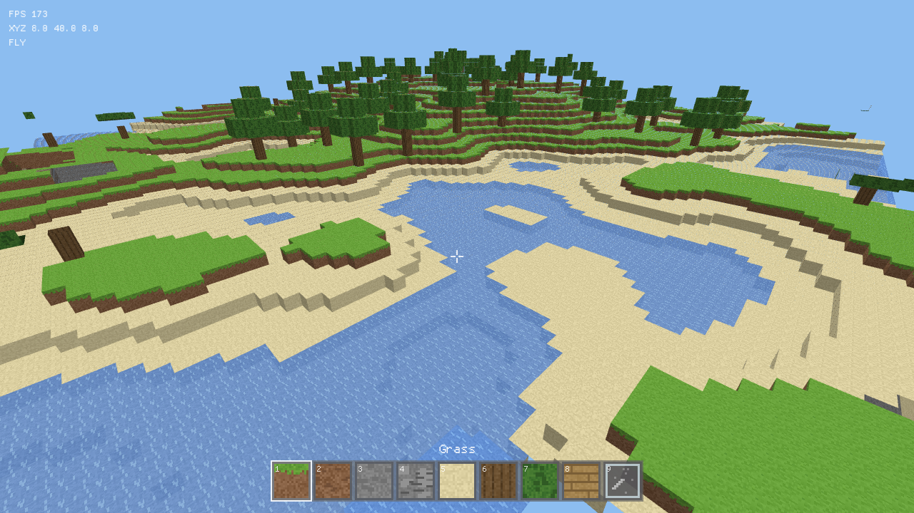

# Rustblox

Свой воксельный «майнкрафт» на Rust + macroquad: генерация мира, чанки, текстуры,
разрушение и установка блоков, полёт и плавание. Все текстуры генерируются кодом —
никаких чужих ассетов.

## Запуск

```powershell
cd rustblox
cargo run --release
```

Или двойной клик по `run.bat` (собирает и запускает).

Первый запуск собирает зависимости, это занимает пару минут. Дальше — секунды.

В меню мир выбирается или создаётся по **клику мышью** или по **Enter**. Клик
удобнее: он сразу передаёт окну фокус клавиатуры — без фокуса Windows не отдаёт
игру «сырой» ввод мыши, и обзор не крутится. В релизной сборке консольного окна
нет (оно тоже могло перехватывать фокус).





## Главное меню

При запуске открывается меню в стиле Minecraft: **Play / Settings / Quit**.
Управление: стрелки + Enter или мышь. За меню медленно вращается камера по миру.

- **Play** — открыть список миров (**Select world**): имя, сид, размер и когда
  мир сохранялся. Ниже кнопки **Play selected / Create new world / Settings /
  Delete / Recreate / Back**. Список листается колесом мыши, стрелками
  выбирается мир, Enter — играть, Delete — удалить (нужно подтвердить: кнопка
  превращается в **Sure?**).
- **Create new world** — имя (до 24 символов), сид (пусто или **Random** —
  случайный), размер мира и **режим игры** (Creative или Survival). Enter —
  создать.
- **Settings** — чувствительность мыши, угол обзора (FOV 55–100), дальность
  прорисовки (80–320) и полноэкранный режим. Значения меняются стрелками или
  кликом по полоске и сохраняются в `rustblox.cfg` рядом с игрой.
- **Quit** — выход.

**Esc** во время игры открывает меню паузы: Resume / Settings / Quit to menu.
При выходе в меню мир сохраняется. Esc в паузе — вернуться в игру.

## Режимы игры

Режим выбирается при создании мира и хранится в сохранении (в списке миров
показан рядом с сидом).

| | Creative | Survival |
|---|---|---|
| Полёт | F, есть всегда | нет |
| Блоки | бесконечные, ломаются мгновенно | ломаются с выдержкой, тратятся |
| Здоровье | не теряется | 20 HP, падение и утопление ранят |
| Дроп | нет | блоки и руды падают в инвентарь |

В Creative **E** открывает палитру всех блоков (клик — взять стак), а
**средняя кнопка мыши** копирует блок под прицелом в хотбар.

## Инвентарь, HP и крафт

- **E** — инвентарь: 36 слотов (9 хотбара + 27), сетка крафта 2×2 и слот
  результата. ЛКМ — взять/положить стак, ПКМ — половину или один предмет.
- **Книга рецептов** — кнопка **Recipes (R)** в инвентаре: список всех рецептов,
  доступных на текущей станции, с иконкой результата и списком ингредиентов.
  Клик по строке сам раскладывает предметы в сетку крафта (если их хватает),
  подсвечивая недоступные рецепты серым. Колесо мыши и стрелки — страницы.
- **Верстак** (4 доски) даёт сетку 3×3: правый клик по верстаку открывает
  крафт. **Печь** (8 булыжников по кругу на верстаке) добавляет плавку:
  руда + уголь → слиток, песок + уголь → стекло.
- Рецепты: бревно → 4 доски, 2 доски → 4 палки, 4 доски → верстак,
  4 булыжника → 4 каменных кирпича, 8 булыжников → печь.
- Здоровье: 10 сердец внизу экрана. Урон от падения выше 3 блоков и от
  долгого пребывания под водой (полоска воздуха). Медленно
  восстанавливается; яблоко (падает с листвы) лечит на 2 сердца (ПКМ).
- Смерть: экран **YOU DIED**, через пару секунд возрождение у точки спавна,
  инвентарь сохраняется.
- В Survival блоки ломаются не мгновенно: у каждого своя твёрдость, над
  прицелом идёт полоска прогресса.

## Руды

В камне под землёй встречаются жилы: уголь (везде), железо (до ~52),
золото (до ~38), алмазы (до ~22). Руда выпадает предметом: уголь, сырое
железо, сырое золото, алмаз; в печи они превращаются в слитки.

## Миры

Мир — это отдельный файл в папке `worlds/` (создаётся рядом с игрой), по файлу
на мир: `worlds/world_<время в мс>.rbw`. Имя мира хранится внутри файла, поэтому
файлы можно свободно переименовывать.

Размеры при создании:

| Размер | Блоков | Чанков |
|---|---|---|
| Small | 128 × 128 | 8 × 8 |
| Normal | 192 × 192 | 12 × 12 |
| Large | 256 × 256 | 16 × 16 |

Высота везде 64 блока. **Recreate** пересоздаёт выбранный мир с тем же сидом и
размером (старые постройки пропадают).

Сохранение: заголовок `RBW3` (сид, число чанков, имя, позиция и поворот камеры,
выбранный слот, режим, здоровье и 36 слотов инвентаря), дальше блоки, сжатые
RLE (пара «длина u16 + id блока»). Рельеф не пишется — он детерминированно
восстанавливается из сида. Старые файлы `RBW2` читаются как Creative. Мир
сохраняется автоматически раз в 15 секунд после изменений, при Esc и при выходе
в меню.

## Управление

| Клавиша | Действие |
|---|---|
| WASD | движение |
| Мышь | обзор |
| Space | прыжок / плыть вверх / подъём в полёте |
| Shift | бег |
| Ctrl | снижение в полёте (Creative) |
| F | включить/выключить полёт (Creative) |
| ЛКМ | сломать блок (в Survival — держать) |
| ПКМ | поставить блок / открыть верстак, печь / съесть яблоко |
| СКМ | скопировать блок под прицелом (Creative) |
| 1–9, колесо | выбор слота хотбара |
| E | инвентарь и крафт |
| Esc | пауза (меню) |

## Что уже есть

- Миры любого из трёх размеров (до 256 × 256), высота 64, чанки 16 × 16.
- Список миров с сидами, сохранение/загрузка, удаление и пересоздание.
- Режимы Creative и Survival, инвентарь на 36 слотов с хотбаром.
- Крафт 2×2, верстак 3×3, печь с плавкой руды.
- Книга рецептов: список крафтов станции, автораскладка ингредиентов в сетку.
- Здоровье, урон от падения и утопления, еда, смерть и возрождение.
- Руды: уголь, железо, золото, алмазы (жилами, на разной глубине).
- Рельеф на value-noise (4 октавы), пляжи, озёра с прозрачной водой, снежные вершины.
- Деревья, угольная и железная руда в камне.
- Физика игрока: AABB-коллизии, гравитация, прыжок, плавание, полёт.
- Разрушение/установка блоков с рейкастом по вокселям (DDA) и подсветкой грани.
- HUD: хотбар из 9 блоков, прицел, координаты, FPS, название блока под прицелом.
- Процедурный атлас 16 × 16 тайлов (16 px), фильтрация Nearest.

## Структура

| Файл | Что внутри |
|---|---|
| `src/main.rs` | окно, игровой цикл, ввод, HUD, камера, загрузка миров и автосейв |
| `src/world.rs` | чанки, генерация рельефа и деревьев, меши, доступ к блокам, сохранение миров |
| `src/blocks.rs` | реестр блоков: тайлы по граням, твёрдость, дроп |
| `src/items.rs` | предметы и стаки, кодирование для сохранений |
| `src/inventory.rs` | инвентарь, хотбар, экран инвентаря и сердечки |
| `src/crafting.rs` | рецепты и проверка сетки крафта |
| `src/player.rs` | движение, коллизии, рейкаст, здоровье и урон |
| `src/menu.rs` | меню, список миров, создание мира, пауза, настройки и их сохранение |
| `src/atlas.rs` | генерация текстурного атласа пиксель за пикселем |
| `src/auth.rs` | локальные аккаунты (пока не подключены к UI) |

## Свои текстуры

Атлас собирается в `atlas::build_atlas()`: 16 тайлов 16 × 16 в сетке 16 × 16.
Чтобы поставить свой пак — положи PNG-атлас 256 × 256 в `assets/` и замени
`build_atlas()` на загрузку файла (`Texture2D::from_file_with_format`), сохранив
раскладку тайлов и `FilterMode::Nearest`.

## Отладка

Скриншот без ручного управления:

```powershell
cargo run --release -- --shot out.png
cargo run --release -- --shot out.png --cam 64,45,64,0.9,-0.4
cargo run --release -- --shot glass.png --glass
cargo run --release -- --shot book.png --book
```

`--cam` принимает `x,y,z,yaw,pitch` (радианы), `--seed 42` — сид мира для
скриншота, `--glass` — ставит перед камерой демо-стену из стекла с блоками за
ней (проверка прозрачности), `--book` — открывает инвентарь с книгой рецептов
и набором материалов.

Тесты формата сохранения (RLE и заголовок):

```powershell
cargo test --release
```

Автотесты ввода и снимок окна (PowerShell, нужен запущенный exe):

```powershell
.\test-input.ps1 -Tag grab -GameArgs @('--play')   # пишет лог ввода в %TEMP%\opencode
.\capture.ps1 -Out out.png -Click                   # снимок окна игры
```

`--play` — сразу начать игру без меню, `--input-log <файл>` — писать состояние
мыши и камеры каждый кадр, `--no-grab` — не захватывать курсор.

## Планы

- Инструменты (кирка/топор), прочность и скорость добычи.
- Пещеры, больше руд, сундуки и хранилища.
- День/ночь, туман, звуки шагов.
- Экран входа на базе `auth.rs`.
- Подгрузка чанков на лету и миры без фиксированной границы.
