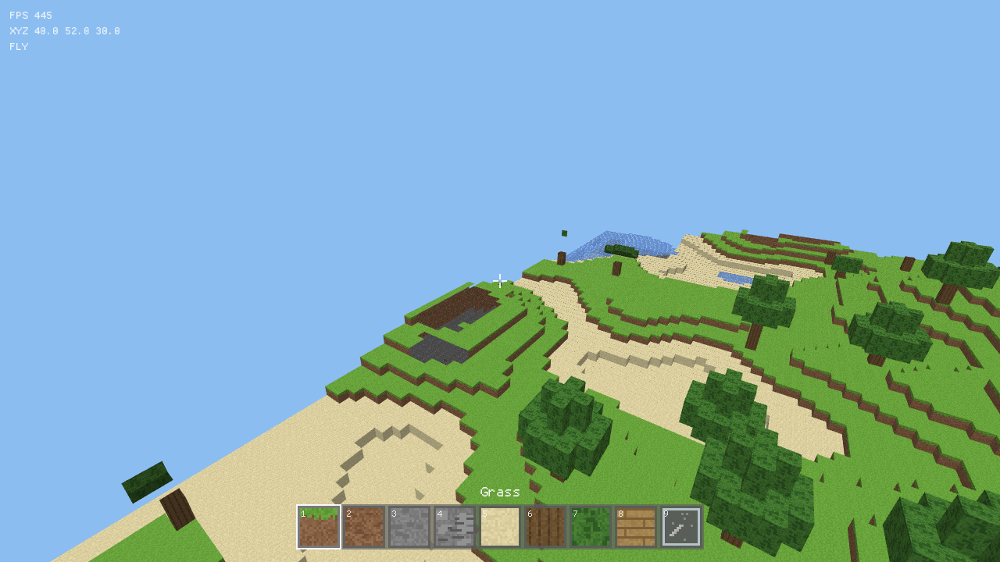
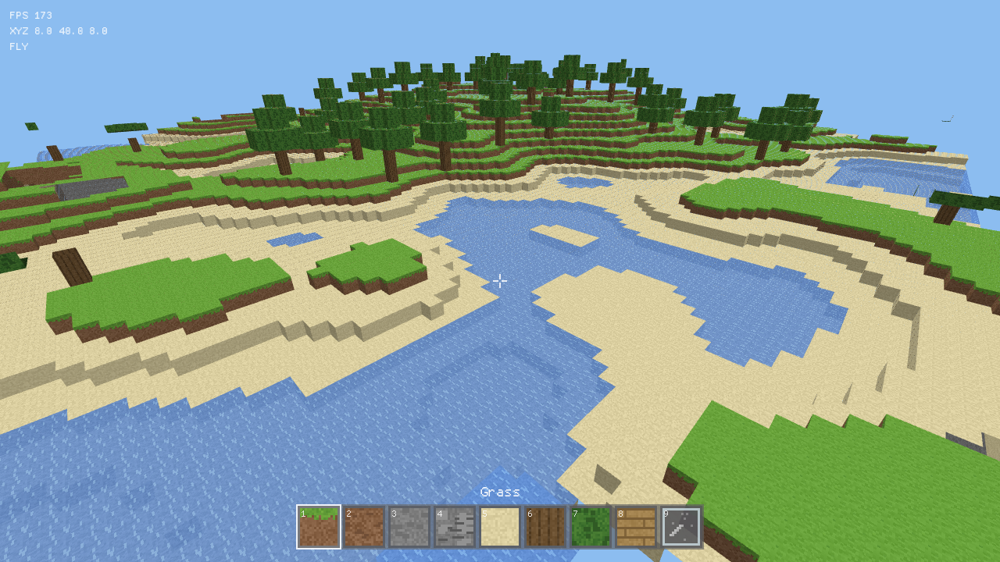

# Rustblox

**A voxel sandbox in Rust** — procedural worlds, Creative and Survival modes,
mining, crafting, ores and a recipe book. Built with
[macroquad](https://macroquad.rs), every texture generated in code, no external
assets.

[](https://github.com/barq3026-dot/rustblox/actions/workflows/ci.yml)
[](https://github.com/barq3026-dot/rustblox/releases)
[](LICENSE)
[](https://www.rust-lang.org)
[](#download)
[](https://macroquad.rs)

 

## Download

Grab the latest Windows build from
[**Releases**](https://github.com/barq3026-dot/rustblox/releases/latest):
unzip `rustblox-1.0.0-windows-x64.zip` and run `rustblox.exe`. No installer,
no runtime dependencies.

## Build from source

```powershell
git clone https://github.com/barq3026-dot/rustblox.git
cd rustblox
cargo run --release
```

Or double-click `run.bat`, which builds and starts the game. Requires a stable
Rust toolchain. The first build takes a couple of minutes, later starts are
instant. Release builds open no console window.

## Features

| | |
|---|---|
| **Worlds** | 128², 192² or 256² blocks, height 64, custom or random seed; world list with load, delete and recreate |
| **Terrain** | value-noise heightmap, beaches, lakes with water, snow peaks, trees, ore veins |
| **Creative** | flight, instant mining, infinite blocks, full block palette, middle-click pick |
| **Survival** | 20 HP, fall and drowning damage, regeneration, death and respawn, item drops |
| **Mining** | per-block hardness, progress bar, shrinking outline |
| **Inventory** | 36 slots, hotbar, take/put/split with the mouse, stack cursor |
| **Crafting** | 2×2 hand grid, 3×3 crafting table, furnace smelting, mirror-matched shaped recipes |
| **Recipe book** | every recipe of the current station, one click fills the craft grid |
| **Ores** | coal anywhere, iron below ~52, gold below ~38, diamonds below ~22 |
| **Rendering** | procedural 16×16 atlas, chunked meshes, water pass, alpha-tested glass, block outline |
| **UI** | menu, world list, settings, pause, HUD with FPS, seed, position, hearts and air |

## Recipes

| Result | Ingredients | Station |
|---|---|---|
| Planks ×4 | Log ×1 | 2×2 |
| Sticks ×4 | Planks ×2 | 2×2 |
| Crafting table | Planks ×4 | 2×2 |
| Stone bricks ×4 | Cobblestone ×4 | 2×2 |
| Furnace | Cobblestone ×8 | 3×3 |
| Iron ingot | Raw iron + coal | Furnace |
| Gold ingot | Raw gold + coal | Furnace |
| Glass | Sand + coal | Furnace |

Open the recipe book with **R** inside the inventory to see the same list with
icons and auto-fill.

## Controls

| Key | Action |
|---|---|
| WASD | move |
| Mouse | look |
| Space | jump / swim up / fly up |
| Shift | sprint |
| Ctrl | fly down (Creative) |
| F | toggle flight (Creative) |
| LMB | break block (hold in Survival) |
| RMB | place block / open crafting table or furnace / eat apple |
| MMB | pick block (Creative) |
| 1–9, wheel | select hotbar slot |
| E | inventory and crafting |
| R | recipe book |
| Esc | pause menu |

## Save format

One file per world in `worlds/world_<millis>.rbw`. The `RBW3` header stores the
seed, chunk count, world name, player position and rotation, selected slot, game
mode, health and 36 inventory slots; block data follows as RLE runs
(`u16 length + u8 block id`). Terrain is not stored — it is regenerated from the
seed, so saves stay small. `RBW2` files still load (as Creative). Worlds autosave
15 seconds after changes, on Esc and when leaving to the menu.

## Project layout

| File | Contents |
|---|---|
| `src/main.rs` | window, game loop, input, HUD, camera, world loading, autosave |
| `src/world.rs` | chunks, terrain and ore generation, meshes, save/load |
| `src/blocks.rs` | block registry: per-face tiles, hardness, drops |
| `src/items.rs` | items and stacks, save encoding |
| `src/inventory.rs` | inventory, hotbar, inventory/recipe screens, hearts |
| `src/crafting.rs` | recipes and craft-grid matching |
| `src/player.rs` | movement, collisions, raycast, health and damage |
| `src/menu.rs` | menu, world list, creation, pause, settings persistence |
| `src/atlas.rs` | procedural pixel-art texture atlas |
| `src/auth.rs` | local accounts (not wired into the UI yet) |

## Development

```powershell
cargo test --release        # 18 unit tests
cargo build --release
```

Debug flags for screenshots and test scenes:

```powershell
cargo run --release -- --shot out.png                 # render one frame and exit
cargo run --release -- --shot out.png --cam 64,45,64,0.9,-0.4
cargo run --release -- --shot glass.png --glass       # glass transparency scene
cargo run --release -- --shot book.png --book         # recipe book scene
```

`--cam` takes `x,y,z,yaw,pitch` in radians, `--seed 42` picks the world seed,
`--play` skips the menu, `--survival` starts autoplay in Survival, `--no-grab`
leaves the cursor free.

CI runs `cargo check`, `cargo test` and `cargo build` on Windows for every push
and pull request, and uploads the executable as an artifact.

## Roadmap

- **1.1** — tools: pickaxe and axe with durability and mining speed.
- Caves, more ores, chests and storage.
- Day/night cycle, fog, footstep sounds.
- Login screen on top of `auth.rs`.
- Streaming chunks and worlds without a fixed border.

See [CHANGELOG.md](CHANGELOG.md) for release notes.

## Notes

- Textures are original and generated by `atlas::build_atlas()`; no Mojang
  assets are used.
- Detailed Russian documentation: [README-RU.md](README-RU.md).
- License: [MIT](LICENSE).
